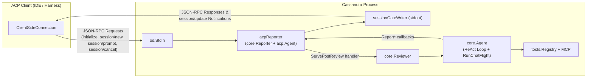

# Agent Client Protocol (ACP) Support in Cassandra

## Overview of ACP

The **[Agent Client Protocol (ACP)](https://agentclientprotocol.com)** is an open, standardized JSON-RPC 2.0 protocol over `stdio` (newline-delimited JSON on `stdin`/`stdout`) that decouples AI coding and review agents from code editors, IDEs, and orchestrators (such as Zed, JetBrains IDEs, Neovim plugins, and custom harnesses).

Key specification resources:
- **Official Specification & Overview**: [https://agentclientprotocol.com/protocol/overview](https://agentclientprotocol.com/protocol/overview)
- **Initialization & Session Setup**: [https://agentclientprotocol.com/protocol/initialization](https://agentclientprotocol.com/protocol/initialization) and [https://agentclientprotocol.com/protocol/session-setup](https://agentclientprotocol.com/protocol/session-setup)
- **Prompt Turn & Streaming Updates**: [https://agentclientprotocol.com/protocol/prompt-turn](https://agentclientprotocol.com/protocol/prompt-turn)
- **Go SDK**: [`github.com/coder/acp-go-sdk`](https://github.com/coder/acp-go-sdk)

---

## Cassandra's ACP Capabilities & How to Enable It

When ACP mode is enabled, Cassandra acts as an ACP Agent over `stdin`/`stdout` while preserving its full automated code review pipeline:

1. **Immediate ACP Handshake**: Cassandra accepts the client's `initialize` and `session/new` requests as soon as it starts.
2. **Real-Time Initial Review Streaming**: Immediately after `session/new` completes, Cassandra executes its normal context gathering (git diff, commit messages, PR metadata, MCP servers) and multi-stage ReAct review loop, streaming every step to the ACP client via `session/update` notifications:
   - **Thoughts & Reasoning** (`agent_thought_chunk`): Initialization status, ReAct iteration markers, and `emit_reviewer_state` focus areas/hypotheses.
   - **Tool Executions** (`tool_call` & `tool_call_update`): Live status (`in_progress` $\to$ `completed` / `failed`), tool kind (`read`, `search`, `other`), and file locations for local and MCP tools.
   - **Review Output** (`agent_message_chunk`): Optional pre-review summary and the final Markdown code review report.
3. **Interactive Post-Review Chat (`session/prompt`)**: Once the initial review finishes, Cassandra transitions into its post-review conversational phase (`RunChatFlight`), retaining the full review conversation history and toolset. The ACP client can send any number of `session/prompt` turns to ask follow-up questions, challenge findings, or request deeper code inspection, and can cancel in-flight turns via `session/cancel`.

### Enabling ACP Mode

ACP mode is disabled by default and is enabled exclusively via the **`--acp` CLI flag**:

```bash
cassandra \
  --acp \
  --provider google \
  --model gemini-2.5-pro \
  --provider-api-key "$GEMINI_API_KEY"
```

### Flag & Configuration Rules

- **CLI-Only Flag**: `--acp` can only be passed on the command line. Setting `acp = true` or `render = "acp"` inside `cassandra.toml` is rejected.
- **Implied Settings**: Passing `--acp` automatically sets `--render=acp` and `--interactive-post-review=true`.
  - Combining `--acp` with a conflicting `--render` mode (e.g., `--render=tui` or `--render=markdown`) or `--interactive-post-review=false` returns a validation error.
- **Non-Interactive Initial Review (`ask_developer` Disabled)**: During the automated review pass, the `ask_developer` tool is disabled in ACP mode so the initial review streams to completion without blocking on mid-review terminal prompts; all developer interaction happens in the ACP `session/prompt` chat phase.
- **Strict `stdout` / `stderr` Separation**: In ACP mode, `stdout` is reserved strictly for newline-delimited JSON-RPC 2.0 ACP frames. All non-ACP diagnostics and warnings are routed to `stderr`. Still-configured side-effect flags (`--review-output-file`, `--output-json`, `--metrics-json`) continue to write directly to their target files on disk.

---

## Technical Architecture

Cassandra implements ACP in [`core/acp.go`](core/acp.go) through `acpReporter` (constructed via `core.NewACPReporter`), which implements both [`core.Reporter`](core/agent.go) and `acp.Agent` from `github.com/coder/acp-go-sdk`.



### End-to-End Sequence

1. **Handshake & Ordering Gate (`sessionGateWriter`)**:
   - `NewACPReporter` starts `acp.NewAgentSideConnection` on a background goroutine.
   - Any `core.Reporter` calls invoked while Cassandra boots wait on `sessionReady` before emitting `session/update` notifications.
   - When the client sends `session/new`, `NewSession` arms `sessionGateWriter` so `sessionReady` is closed immediately *after* the `NewSessionResponse` JSON-RPC frame is flushed to `stdout`. This guarantees deterministic wire ordering where `session/update` notifications never precede the `session/new` response.
2. **Initial Review Phase**:
   - `Reviewer.Run` executes the pre-review and main review ReAct loops (`Agent.RunReview`).
   - Progress callbacks (`ReportConfig`, `ReportFetchingDiff`, `ReportIteration`, `ReportToolCalls`, `ReportToolStatus`, `ReportStageReview`, `ReportReview`) translate directly into ACP `session/update` notifications (`UpdateAgentThoughtText`, `StartToolCall`, `UpdateToolCall`, `UpdateAgentMessageText`).
3. **Post-Review Chat Phase (`ServePostReview`)**:
   - `Reviewer.RunInteractivePostReview` appends the post-review system instruction to `Agent.history` and calls `acpReporter.ServePostReview`.
   - `ServePostReview` registers the turn callback (`Reviewer.executePostReviewTurn`) and closes `reviewReady`, unblocking any queued or subsequent `session/prompt` RPCs.
   - Each `Prompt` call runs `Agent.RunChatFlight` with a per-turn cancellable context, streams any tool calls/thoughts plus the assistant's reply via `ReportPostReviewReply`, accumulates token/tool metrics into `Reviewer.DiscussionMetrics`, and returns `StopReasonEndTurn` (or `StopReasonCancelled` if interrupted via `session/cancel`).

```mermaid
sequenceDiagram
    participant Client as ACP Client
    participant ACP as acpReporter (acp.Agent)
    participant Reviewer as core.Reviewer / core.Agent

    Client->>ACP: initialize
    ACP-->>Client: InitializeResponse (protocolVersion, capabilities)

    Client->>ACP: session/new (cwd, mcpServers)
    ACP-->>Client: NewSessionResponse (sessionId: "sess_1")
    Note over ACP,Reviewer: sessionGateWriter unblocks sessionReady after response flush

    Reviewer->>ACP: ReportConfig / ReportFetchingDiff / ReportIteration
    ACP--)Client: session/update (agent_thought_chunk)

    Reviewer->>ACP: ReportToolCalls (emit_reviewer_state, read_file, ...)
    ACP--)Client: session/update (agent_thought_chunk / tool_call [in_progress])

    Reviewer->>ACP: ReportToolStatus (completed / failed)
    ACP--)Client: session/update (tool_call_update [completed / failed])

    Reviewer->>ACP: ReportReview (final Markdown review)
    ACP--)Client: session/update (agent_message_chunk)

    Reviewer->>ACP: RunInteractivePostReview -> ServePostReview()
    Note over ACP: reviewReady closed; ready for session/prompt turns

    loop Interactive Post-Review Chat
        Client->>ACP: session/prompt (ContentBlocks)
        ACP->>Reviewer: executePostReviewTurn -> Agent.RunChatFlight
        Reviewer->>ACP: ReportToolCalls / ReportPostReviewReply
        ACP--)Client: session/update (tool_call / agent_message_chunk)
        ACP-->>Client: PromptResponse (stopReason: "end_turn")
    end

    Client->>ACP: session/close (or EOF on stdin)
    ACP-->>Client: CloseSessionResponse
```
