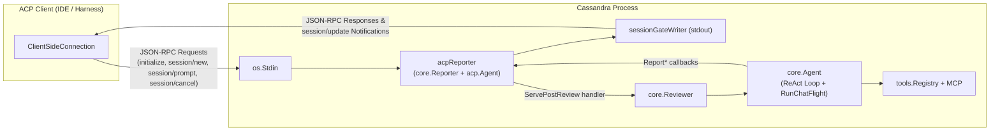

# Agent Client Protocol (ACP) Support in Cassandra

## Overview of ACP

The **[Agent Client Protocol (ACP)](https://agentclientprotocol.com)** is an open, standardized JSON-RPC 2.0 protocol over `stdio` (newline-delimited JSON on `stdin`/`stdout`) that decouples AI coding and review agents from code editors, IDEs, and orchestrators (such as Zed, JetBrains IDEs, Neovim plugins, and custom harnesses).

Key specification resources:
- **Official Specification & Overview**: [https://agentclientprotocol.com/protocol/overview](https://agentclientprotocol.com/protocol/overview)
- **Initialization & Session Setup**: [https://agentclientprotocol.com/protocol/initialization](https://agentclientprotocol.com/protocol/initialization) and [https://agentclientprotocol.com/protocol/session-setup](https://agentclientprotocol.com/protocol/session-setup)
- **Prompt Turn & Streaming Updates**: [https://agentclientprotocol.com/protocol/prompt-turn](https://agentclientprotocol.com/protocol/prompt-turn)
- **Session Modes**: [https://agentclientprotocol.com/protocol/session-modes](https://agentclientprotocol.com/protocol/session-modes)
- **Agent Plan**: [https://agentclientprotocol.com/protocol/agent-plan](https://agentclientprotocol.com/protocol/agent-plan)
- **Extensibility**: [https://agentclientprotocol.com/protocol/extensibility](https://agentclientprotocol.com/protocol/extensibility)
- **Go SDK**: [`github.com/coder/acp-go-sdk`](https://github.com/coder/acp-go-sdk)

---

## Cassandra's ACP Capabilities & How to Enable It

When ACP mode is enabled, Cassandra acts as an ACP Agent over `stdin`/`stdout` while preserving its full automated code review pipeline:

1. **Immediate ACP Handshake**: Cassandra accepts the client's `initialize` and `session/new` requests as soon as it starts.
2. **Session Mode & Model Metadata (`session_mode` & `configOptions`)**:
   - `NewSessionResponse` advertises the single session mode `review` (*Code review* — analyzing git diff, commit history, and repository context) and reports Cassandra's configured main model (`--model`) via `configOptions` (`category: "model"`).
3. **Session Metadata & Dynamic Title (`session_info_update`)**:
   - Cassandra dynamically pushes `session_info_update` notifications setting a human-readable title (e.g., `Code Review: main..HEAD (5 files, gemini-2.5-pro)`) and rich `_meta` attributes (`provider`, `model`, `base`, `head`, `targetDir`, `changedFiles`, `guidelines`).
4. **Execution Plan Checklist (`plan`)**:
   - Cassandra publishes and live-updates an ACP Execution Plan (`entries` with `content`, `priority`, and `status`: `pending` $\to$ `in_progress` $\to$ `completed`):
     - `Gather git diff and commit context`
     - `Generate pre-review summary` (when `--pre-review-prompt` is configured)
     - `Inspect code and formulate review`
5. **Context Window & Token Usage (`usage_update`)**:
   - On each interaction (during review iterations and post-review chat turns), Cassandra emits `usage_update` notifications reporting context token usage (`used`, `size`, and granular per-turn & cumulative tokens in `_meta`).
6. **Real-Time Initial Review Streaming**:
   - Immediately after `session/new` completes, Cassandra executes its context gathering and multi-stage ReAct review loop, streaming progress via `session/update`:
     - **Thoughts & Reasoning** (`agent_thought_chunk`): Status updates, ReAct iteration markers, and `emit_reviewer_state` hypotheses.
     - **Tool Executions** (`tool_call` & `tool_call_update`): Live status (`in_progress` $\to$ `completed` / `failed`), tool kind (`read`, `search`, `other`), and file locations.
     - **Review Output** (`agent_message_chunk`): Optional pre-review summary and final Markdown code review report.
7. **Interactive Post-Review Chat (`session/prompt`)**:
   - Cassandra transitions into its post-review conversational phase (`RunChatFlight`), retaining full review conversation history and tools. The ACP client can send any number of `session/prompt` turns to ask follow-up questions, challenge findings, or request deeper inspection, and can cancel in-flight turns via `session/cancel`.

### Enabling ACP Mode

ACP mode is disabled by default and is enabled exclusively via the **`--acp` CLI flag**:

```bash
cassandra \
  --acp \
  --provider google \
  --model gemini-2.5-pro \
  --provider-api-key "$GEMINI_API_KEY"
```

### Flag & Configuration Rules

- **CLI-Only Flags**: `--acp` and `--wait-for-message` can only be passed on the command line. Setting `acp = true`, `wait-for-message = true`, or `render = "acp"` inside `cassandra.toml` is rejected.
- **Implied Settings**: Passing `--acp` automatically sets `--render=acp` and `--interactive-post-review=true`.
  - Combining `--acp` with a conflicting `--render` mode (e.g., `--render=tui` or `--render=markdown`) or `--interactive-post-review=false` returns a validation error.
- **Deferred Review Start & Initial User Focus (`--wait-for-message` and Pre-Review Focus)**:
  - **With `--wait-for-message`**: Cassandra completes the `initialize` and `session/new` handshake and gathers initial context, then waits for the first `session/prompt` user message before starting the pre-review summary and initial code review.
  - **Without `--wait-for-message` (when `--pre-review-prompt` is configured)**: Cassandra automatically runs and streams the `# Pre-Review Summary` after `session/new` along with *"Is there anything you want me to focus on in this review?"*, and then waits for the user's first `session/prompt` message before starting the main code review.
  - In both flows, if the user's first message contains non-whitespace text, it is appended to the review request inside `<extra_initial_user_context_or_guidelines>...</extra_initial_user_context_or_guidelines>`, and that first prompt turn completes once the review is emitted. Subsequent `session/prompt` turns are handled as interactive post-review chat turns.
- **Developer Clarification via ACP Elicitation (`ask_developer`)**: When `--allow-ask-developer` is enabled, Cassandra supports the `ask_developer` tool in ACP mode using the ACP elicitation protocol (`create_elicitation`). If the connected ACP client advertises form elicitation capabilities (`clientCapabilities.elicitation.form`), clarification questions with structured candidate options and free-form input are sent directly as interactive elicitation forms. If the client does not support elicitation forms or declines, the reviewer gracefully falls back and continues with documented assumptions.
- **Strict `stdout` / `stderr` Separation**: In ACP mode, `stdout` is reserved strictly for newline-delimited JSON-RPC 2.0 ACP frames. All non-ACP diagnostics and warnings are routed to `stderr`. Still-configured side-effect flags (`--review-output-file`, `--output-json`, `--metrics-json`) continue to write directly to their target files on disk.

---

## Technical Architecture

Cassandra implements ACP in [`core/acp.go`](core/acp.go) through `acpReporter` (constructed via `core.NewACPReporter`), which implements both [`core.Reporter`](core/agent.go) and `acp.Agent` from `github.com/coder/acp-go-sdk`.



### End-to-End Sequence

1. **Handshake & Ordering Gate (`sessionGateWriter`)**:
   - `NewACPReporter` starts `acp.NewAgentSideConnection` on a background goroutine.
   - Any `core.Reporter` calls invoked while Cassandra boots wait on `sessionReady` before emitting `session/update` notifications.
   - When the client sends `session/new`, `NewSession` advertises available session modes (`review`, `chat`) and arms `sessionGateWriter` so `sessionReady` is closed immediately *after* the `NewSessionResponse` JSON-RPC frame is flushed to `stdout`. This guarantees deterministic wire ordering where `session/update` notifications never precede the `session/new` response.
2. **Initial Review Phase**:
   - `Reviewer.Run` executes the pre-review and main review ReAct loops (`Agent.RunReview`).
   - Progress callbacks (`ReportConfig`, `ReportFetchingDiff`, `ReportIteration`, `ReportToolCalls`, `ReportToolStatus`, `ReportStageReview`, `ReportReview`, `ReportUsage`) translate directly into ACP `session/update` notifications:
     - `session_info_update`: sets title and metadata (`provider`, `model`, `base`, `head`, `changedFiles`)
     - `plan`: updates review stages (`in_progress` $\to$ `completed`)
     - `agent_thought_chunk` & `tool_call`: real-time tool execution & thoughts
     - `usage_update`: context token consumption
     - `agent_message_chunk`: final review report
3. **Post-Review Chat Phase (`ServePostReview`)**:
   - `Reviewer.RunInteractivePostReview` appends the post-review system instruction to `Agent.history` and calls `acpReporter.ServePostReview`.
   - `ServePostReview` transitions the session mode to `chat` (`current_mode_update`), registers the turn callback (`Reviewer.executePostReviewTurn`), and closes `reviewReady`.
   - Each `Prompt` call runs `Agent.RunChatFlight` with a per-turn cancellable context, streams tool calls/thoughts plus the assistant's reply via `ReportPostReviewReply`, reports turn token usage via `usage_update`, accumulates token/tool metrics into `Reviewer.DiscussionMetrics`, and returns `StopReasonEndTurn` (or `StopReasonCancelled` if interrupted via `session/cancel`).

```mermaid
sequenceDiagram
    participant Client as ACP Client
    participant ACP as acpReporter (acp.Agent)
    participant Reviewer as core.Reviewer / core.Agent

    Client->>ACP: initialize
    ACP-->>Client: InitializeResponse (protocolVersion, capabilities)

    Client->>ACP: session/new (cwd, mcpServers)
    ACP-->>Client: NewSessionResponse (sessionId, modes: [review, chat])
    Note over ACP,Reviewer: sessionGateWriter unblocks sessionReady after response flush

    Reviewer->>ACP: ReportConfig / ReportFetchingDiff
    ACP--)Client: session/update (session_info_update: title & _meta)
    ACP--)Client: session/update (plan: context gathering in_progress)
    ACP--)Client: session/update (agent_thought_chunk)

    Reviewer->>ACP: ReportToolCalls (emit_reviewer_state, read_file, ...)
    ACP--)Client: session/update (agent_thought_chunk / tool_call [in_progress])

    Reviewer->>ACP: ReportToolStatus (completed / failed)
    ACP--)Client: session/update (tool_call_update [completed / failed])

    Reviewer->>ACP: ReportUsage
    ACP--)Client: session/update (usage_update: context tokens & meta)

    Reviewer->>ACP: ReportReview (final Markdown review)
    ACP--)Client: session/update (agent_message_chunk)
    ACP--)Client: session/update (plan: review step completed)

    Reviewer->>ACP: RunInteractivePostReview -> ServePostReview()
    ACP--)Client: session/update (current_mode_update: mode="chat")
    Note over ACP: reviewReady closed; ready for session/prompt turns

    loop Interactive Post-Review Chat
        Client->>ACP: session/prompt (ContentBlocks)
        ACP->>Reviewer: executePostReviewTurn -> Agent.RunChatFlight
        Reviewer->>ACP: ReportToolCalls / ReportPostReviewReply / ReportUsage
        ACP--)Client: session/update (tool_call / agent_message_chunk / usage_update)
        ACP-->>Client: PromptResponse (stopReason: "end_turn")
    end

    Client->>ACP: session/close (or EOF on stdin)
    ACP-->>Client: CloseSessionResponse
```
